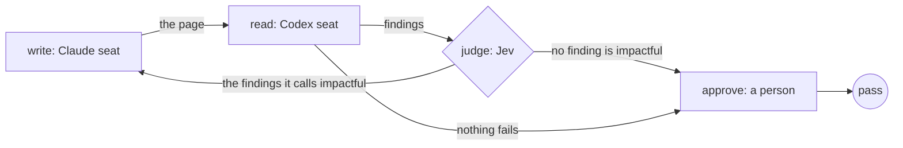

Give a small decision model the job of deciding whether another revision
would improve the work. Use it for a page, a plan or a shortlist when you
can't know how many rounds it will need.

The reviewer says what needs fixing. The judge reads each note and the
history of revisions, then calls each one: act or skip in round 1,
impactful or minor after. When at least one is sent back, the workflow
carries those notes
to the writer and runs the next round. When none is, the work
stands.
With no cap, a run ends when the judge stops it or the review passes. You
can add a cap as a backstop. Put a person's decision where the process
needs one; this example asks before publication.
If a fixed number of rounds is enough,
[get a second opinion](/patterns/writer-and-reviewer)
and set the writer's revision limit.

## Shape



## The stopping rule

The judge's seat is `jev()` from
[`@obversa/engine-jev-api`](/packages/engine-jev-api), one line like any
other seat. Offline, `recordedJudge` from `@obversa/runtime/testing` stands
in for it and replays the answers in `judge.json`:

```ts examples/judge-stops-the-loop.ts (excerpt)
const judgeSeat = process.env.JUDGE === 'jev' ? jev() : recordedJudge('judge.json');
```

The judge sits on the `write` stage. The reader reviews the page, and
`refine` names the judge:

```ts examples/judge-stops-the-loop.ts (excerpt)
    stage('write', {
      agent: 'write',
      writes: file,
      reviewedBy: 'read',
      refine: judge(judgeSeat),
      desc: 'Rewrite the page so a person reads it once and knows what to do. On a later round, change only the sentences the findings name.',
      gate: 'The reader finds nothing that fails, or the judge says the page holds for this use case.',
    }),
```

The brief tells the reader to tag each finding `block`, `should-fix` or
`nice-to-have`. A block is a false claim or a sentence a person would not
understand.

When a judge is set, it answers one question per finding, a block included,
with a one-line reason. In round 1 it chooses `act` or `skip`: act when a
reader of this kind of work would stumble on, misread or distrust what the
finding names, skip when it is taste, an edge case, or polish past the bar
the use case sets. From the second round on it answers a yes or a no:
is the finding impactful enough to send the work back, or minor? That
question separates an impactful
finding (behaviour wrong under normal use, a requirement of the brief
unmet, a test that cannot fail, or a risk of data loss, a security hole or
a broken rule of the work) from a minor one (wording, style, naming, an
edge case outside real use, or a nice-to-have). A real finding is not waved
through because the rest of the list was trivial.

- **The judge sends at least one finding back.** The page goes back:
  the writer gets only the findings the judge sent back, each with
  the judge's reason.
- **The judge holds every finding back.** The page stands as a pass,
  with the judge's reason.
- **The reader's next round.** The reader is told which findings did not
  go back and why, so it does not raise them again.

A finding the judge holds back never goes to the writer again, whatever
the reviewer tagged it: it is recorded `skip` in round 1 and `minor`
from the second round on, and each is collected on `minorFindings`
with its reviewer and the evidence it wrote, where a file and line
usually sit: the list a person reads before the work
lands. The judge's own answer routes the finding; the reviewer's tag only
informs what the judge reads.

With no cap, the rounds end when the judge stops them or the reader finds
nothing that fails. A reader that tags every finding block does not decide
alone how long the run goes on, because the judge still weighs each block.
A block is sent back without a judge only when there is no judge: a plain
`refine` number on a `workflow()` stage, or `rounds` in a `dag()` node's
`review()`.

When the stage also sets `goal`, a goal check runs before the reader,
every round. A requirement of the brief that it finds unmet goes straight
back to the writer. The reader does not run that round, and the judge is
not asked, because a requirement in the brief is never skipped as polish.
[Check the brief was met](/patterns/check-the-brief) shows it.

The approval is a plain function. It reads the page, puts its sha256 in the
question and sends a person's no back to the writer.

With several reviewers, set `synthesise` on the stage as well. The panel
then merges the findings that name the same problem, lets each reviewer
vote once on the findings it did not raise, and drops a finding when the
reviewers who reject it outnumber those who raised or backed it, unless it
is a block. The judge decides each finding on that one
list, with who raised it and how the others voted.
[Ask a panel](/patterns/review-panel) shows it.

## A cap as a backstop

To bound the rounds as well, pass a cap: `judge(judgeSeat, { cap: 3 })`.
A cap of 3 allows three [refinements](/concepts/feedback-loops#counting-rounds):
the first draft and three more, four builds the reviews paid for. It means
the same on a `workflow()` stage's `refine` and in a `dag()` node's
`review({ judge })`.
A failed check or a declared file left missing sends the work back on the
check budget, not the cap: up to `checkRounds` more builds (3 by default,
and on a `workflow()` stage a panel reviews).

When the review of the last build does not pass, the judge is asked about
it too and told that this is the last round. Its answer decides the outcome:

- **`holds` or `over_polishing`.** The work stands as a pass with the
  judge's reason. The findings still open are on the outcome as
  `openFindings`, and in the judge's entry in the record.
- **`product_decision`.** A person is asked, and their answer buys exactly
  one more round, past the cap, so the builder can apply it. The record
  marks the send-back `productDecision`. Each product decision a person
  answers buys its own round that way.
- **`continue` or `not_converging`, with no impactful finding acted on.**
  When the judge is deciding each finding, as on this page, no acted
  finding means the work stands: the per-finding answers ship the round,
  and the cap leaves that pass in place. The run fails only when the judge does
  not decide each finding, with custom questions and no `perFinding`, or
  when a review raised no findings to decide, and still asks for another
  round past the cap. The reason names the cap.

Findings the judge still calls impactful change the ending. While the
count it acts on is smaller than the round before, the run is still
converging: the spent cap grants one more round, marked `converging` on
the send-back, and the record says why. When the count is not falling,
the run pauses and asks a person, the open findings attached, as a
resumable product decision; their answer buys the round the same way. A
run never ends as a silent fail while findings the judge called impactful
are still open.

When the judge decides each finding on the last round, calling every
finding minor lets the work stand. A block in the last round goes to the
judge too, with the same rules.

## What the judge sees

The judge reads no file itself. The runtime puts together what it reads, in
code, with no extra model call. For the same rounds, a `workflow()` stage
and a `dag()` give the judge the same input. The judge reads it in four
labelled parts, always in this order, and then the questions. The four
parts, and `cut` when the size limit cut something, are the `state` of the
judge's `{ state, questions }` prompt.

- **`why`: what the work is for.** The brief, the use case, and the
  target's `desc` and `gate`. A `workflow()` passes its `brief`, and takes
  the use case from the brief's `Use case:` paragraph. A `dag()` passes its
  own `brief` and `useCase`. A person's answers to the judge's earlier
  product decisions are here too.
- **`what`: the change.** In a git workspace, each file changed since the
  run of the workflow or dag began, with the lines added and removed. For
  each changed file and line a finding cites, such as `src/app.ts:42`, the
  parts of the diff within ten lines of that line. A finding that cites a
  file with no line gets that file's whole diff. When the target writes a
  file, the judge also gets its content: the first file a stage `writes`,
  or a dag node's `file`.
- **`how`: this round's evidence.** The latest result of each check step
  in the graph, a `run:` stage or a `commandJob`: its command, its status
  and, when it did not pass, its output. The verdicts of the target's own
  goal check, when it has one. Each finding, with the id its question uses, who
  raised it and its severity. When the panel synthesised, each finding
  also carries the other reviewers' votes and their reasons.
- **`when`: where the rounds stand.** The round number, the cap, and
  whether this is the last round. Every earlier round, with its findings,
  the judge's decision on each and its reason, and how many lines that
  round changed. The findings the judge held back, with its reasons. In a git
  workspace, the files changed since the last round.

### The size limit

What the judge reads can be large, so it is kept to 50000 characters,
counted as JSON. Set another limit with the `judgeContextLimit` option of
`run()`, for example `run(job, { judgeContextLimit: 20000 })`.

When the four parts are over the limit, the runtime cuts every long part
down to one shared length, set so that the whole fits. A short part is cut
only when cutting the long ones is not enough. These parts can be cut:

- **Texts.** The brief, the use case, the `desc`, the `gate`, each diff,
  the file's content and each check's output. A text keeps its start.
- **Lists.** A person's earlier answers, the changed files, the goal
  check's verdicts, the earlier rounds, the findings held back before and
  the files changed since the last round. A list keeps whole items. The
  earlier rounds, the held-back findings and the answers keep the latest.
  The other lists keep their first items.

The findings to decide are never cut. When they, with the names, numbers
and commands around them, are over the limit on their own, what the judge
reads stays over it, and the last note says so.

When the limit cuts something, `cut`, after the four parts, names each
cut, for example
`the content of page.md: kept the first 20000 of 31250 characters`.
Each judge entry in the record names the target and the round. It also
gives the size of what the judge read, in characters, and the same list of
cuts.

## The questions

For each finding in the round, the judge gets one question, keyed
`finding-1`, `finding-2` and so on in the order of the round's findings. In
round 1 it chooses `act` or `skip`: act when a reader of this kind of work
would stumble on, misread or distrust what the finding names; skip when it
is taste, an edge case, or polish past the bar the use case sets. From the
second round on it answers a yes or a no. A
yes calls the finding impactful: behaviour wrong
under normal use, a requirement of the brief unmet, a test that cannot
fail, or a risk of data loss, a security hole or a broken rule of the work.
A no calls it minor: wording, style, naming, an edge case outside real
use, or a nice-to-have. A block keeps its severity in what the judge sees,
and its question sets the same higher bar in either wording: hold it back
only when the case it names is outside how the work is really used, or the
same class of finding keeps returning after it was answered. Otherwise it
goes back. When an
answer carries no reason of its own, the
reason is the text of the matching criterion. The judge
answers these in the same call as the questions about the whole round. The
default set of those is `stopQuestions()` from
[`@obversa/runtime`](/packages/runtime). It asks four questions:

- **`holds`.** For this use case, does the draft hold as it stands?
- **`worth_doing`.** For this use case, are the latest findings worth
  acting on?
- **`worth_another_round`.** Given the whole history, is another round
  worth it?
- **`stop_reason`.** Are we at the point of diminishing returns? The judge
  chooses `holds`, `over_polishing`, `not_converging`, `continue` or
  `product_decision`.

The answers about each finding decide the route. A finding the judge
calls impactful is recorded `act`, and another round runs. One it holds
back is recorded `skip` in the first round and `minor` after it: neither
sends the work back, and each joins the collected list. When
every finding is held back, the work stands as a pass, with the collected
findings on the outcome as `minorFindings`. This holds whatever the round
answers say, so a chosen `not_converging` neither drops a finding the judge
called impactful nor fails a round whose findings are all held back. The
one exception is `product_decision`:
the judge asks a person as described below. When the judge itself cannot
answer, the loop stops rather than spending a build. A failed judge call
pauses the run with the engine's own error. A reply that does not parse,
or that leaves an asked question without a usable answer, pauses it with
a validation error. A resumed run asks the judge again for the same round,
over the review that was already done. Nothing builds and nothing reviews
again first.

A `dag()` node takes the same `judge()` value in `review({ judge })` on its
`refine`, which covers the node's own reviews and the send-backs other
nodes aim at it. The node the work goes back to gets only the findings the
judge called impactful, and a stop means the same thing in both places. The judge
runs as part of the node that sent the work back, inside that node's time
limit. The unmet requirements a `goalCheck()` node sends back go to the
target without the judge.

A stage a person reviews takes the same judge. Each refusal goes to the
judge with the person's note as a finding, as a reviewer's findings do.

Pass your own set as `judge(seat, { questions })` when this wording
does not fit your use case. With your own set, the judge is not asked about
each finding, and the whole round goes back or stands on one answer. When
the judge chooses `holds` or `over_polishing`, the work stands as a pass
carrying the judge's reason. Every other chosen stop leaves the review's
failure in place. A custom question set that wants a reason of its own to
let the work stand names that choice `holds` or `over_polishing`. Add
`perFinding: true` to ask about each finding with your own set as well. The
judge engine takes `{ state, questions }` as its prompt and returns one
answer per question; the [Jev API engine](/packages/engine-jev-api) page has
the shape.

The built-in `stopQuestions()` also offers `product_decision`: the work
needs a person's judgement before review can continue. Pass an `interaction`
binding to `judge()` to open your review surface. Its request includes the
work and the review history. After the person answers, the work goes back
to the writer. The writer gets the person's structured feedback, their
composed prompt and the findings they answered. The review then runs on
the new draft, and only after that does the judge decide again. With a
cap, the round the answer buys counts against it like any other round,
with one exception: a product decision the judge asks after the last
review the cap allows buys exactly one more round, past the cap, and the
record marks the send-back `productDecision`. Each product decision a
person answers buys its own round that way. Without an interaction handler,
answer through the run's stored callbacks client, or on the
[run page](/driving/monitor) with a written decision. This gets an answer while
the work is being revised. A later human review can still require you to
approve the finished work.

## What the run did

Run offline, with the judge's answers replayed from `judge.json` beside the
brief and the person's answer recorded in `approve.json`, the example
printed:

```json Output
{
  "status": "pass",
  "stop": "the judge found only minor findings",
  "approved": true
}
```

Three rounds. The first reader pass found two blocks. The judge acted
on both, so the page went back. The second found a `should-fix` (the page never
says where to run the command) and a `nice-to-have`. The judge called the
first impactful and the second minor, so the writer got only the first. The third
pass found one `nice-to-have`, and the judge called it minor too, so the page stood.
The minor findings stayed on the record as `minorFindings`, for a person
to read before the page lands.

The record holds each round's findings and the judge's answers. Each answer
also says whether the page went back or stopped, which answer decided that,
and for a stop, whether the step passed or failed. It lists each finding's
id with the judge's decision and reason, for example:

```json
[
  { "id": "finding-1", "decision": "act", "reason": "Impactful: behaviour wrong under normal use, a requirement of the brief unmet, a test that cannot fail, or a risk of data loss, a security hole or a broken rule of the work, so the builder should fix it." },
  { "id": "finding-2", "decision": "minor", "reason": "Minor: wording of docs or comments, style, naming, an edge case outside real use, or a nice-to-have, so fixing it would not change what a reader gets." }
]
```
With `JUDGE=jev`, and `TYPESAFE_ENDPOINT` and `TYPESAFE_API_KEY` in the
environment, the same file asks Jev instead of replaying.

## Next steps

- [Feedback loops](/concepts/feedback-loops): the check, the target and the
  stopping rule, and the other shapes a loop takes.
- [Jev API engine](/packages/engine-jev-api): the judge's question types
  and how it reports its identity.
- [A person decides](/patterns/approval): the approval step this loop ends
  on, bound to the exact bytes.
